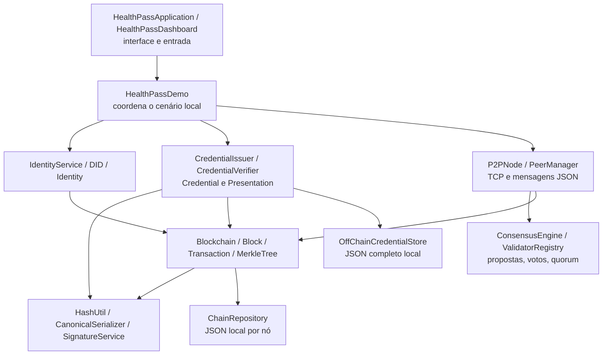
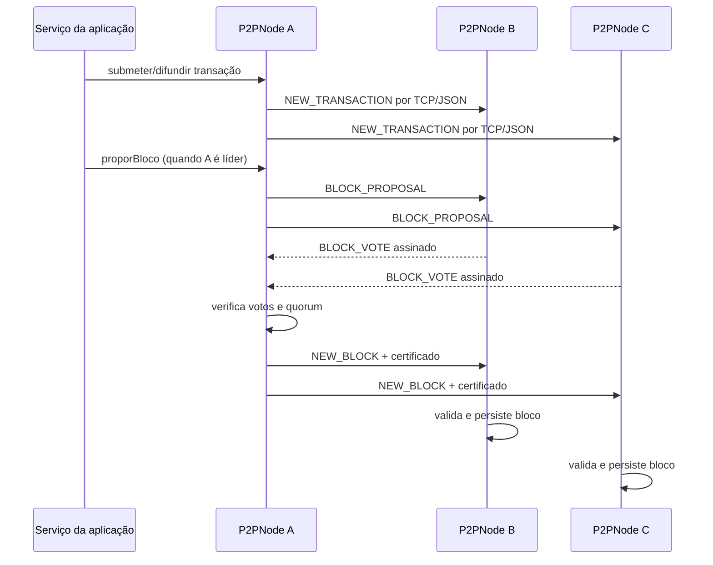

# Arquitetura do HealthPass

Este documento descreve **o sistema que está no código neste momento** e
compara-o com a proposta do relatório `computacao_distribuida.pdf`. O relatório
define a meta: instituições distintas partilham uma âncora verificável de
credenciais, mantêm os dados clínicos fora da cadeia e comunicam através de
vários nós P2P. A aplicação executável é uma prova de conceito local dessa
arquitetura; não representa ainda hospitais independentes ligados pela
Internet.

## 1. Visão geral

As camadas têm responsabilidades diferentes: a GUI recolhe ações e mostra
resultados; serviços de identidade/credencial aplicam regras do caso de uso;
consenso decide se um bloco cumpre a regra da rede; P2P transporta mensagens;
ledger valida e guarda a cadeia. A interface não calcula hashes nem decide o
consenso.

## 2. Diagrama de classes

O diagrama abaixo cobre as classes e tipos principais de produção. Os pequenos
`record` de transporte usados pelo protocolo também estão representados. As
quatro janelas antigas (`IssuerView`, `HolderWalletView`, `VerifierView` e
`AdminView`) são esqueletos sem fluxo ligado; a janela realmente usada é
`HealthPassDashboard`.

```mermaid
classDiagram
    direction LR
    class HealthPassApplication {
      +main(args) void
    }
    class HealthPassDemo {
      -sessionDirectory Path
      -chains List~Blockchain~
      -nodes List~P2PNode~
      -issuerKeys KeyPair
      -latestCredential Credential
      +emitir(code,date) Credential
      +apresentar() CredentialPresentation
      +verificar() Resultado
      +revogar() void
      +estado() String
      +close() void
    }
    class P2PNodeApplication {
      +main(args) void
    }
    class ValidatorEntry {
      <<record>>
      +did String
      +publicKey String
    }
    class HealthPassConfig {
      +QUORUM int
      +NUM_VALIDADORES int
      +EMISSORES_DEMO_AUTORIZADOS Set
    }
    class HealthPassDashboard {
      -demo HealthPassDemo
      +abrir() void
    }

    class DID {
      -identificador String
      +parse(did) DID
      +toString() String
    }
    class Identity {
      -did DID
      -role IdentityRole
      -publicKey PublicKey
      +getDid() DID
      +getRole() IdentityRole
      +getPublicKey() PublicKey
    }
    class IdentityRole {
      <<enumeration>>
      ISSUER
      HOLDER
      VALIDATOR
      ADMIN
    }
    class IdentityService {
      -blockchain Blockchain
      -emissoresConfiaveis Set~String~
      +registar(identity,key) void
      +procurar(did) Identity
      +ehEmissorAutorizado(did) boolean
    }
    class KeyManager {
      +gerarParDeChaves(bits) KeyPair
    }

    class Credential {
      #credentialId String
      #type String
      #issuerDID String
      #holderDID String
      #issuedAt String
      #expiresAt String
      #signature String
      +calcularHash() String
    }
    class VaccinationCredential {
      -vaccineCode String
      -administrationDate String
    }
    class CredentialIssuer {
      -issuerDID DID
      -chavePrivada PrivateKey
      -blockchain Blockchain
      +emitir(credential) void
      +revogar(credentialId) void
    }
    class CredentialVerifier {
      -blockchain Blockchain
      -identityService IdentityService
      +verificar(credential) Resultado
    }
    class Resultado {
      <<record>>
    }
    class CredentialPresentation {
      -credencial Credential
      +paraJson() String
    }
    class CredentialStatus {
      <<enumeration>>
      ACTIVE
      REVOKED
      EXPIRED
    }
    class Issuance {
      <<record>>
    }
    class Revocation {
      <<record>>
    }
    class CredentialTransactionData {
      <<helper>>
    }

    class HashUtil {
      +hash(text) String
      +hash(bytes) String
    }
    class CanonicalSerializer {
      +paraJson(value) String
      +paraJsonSemAssinatura(credential) String
    }
    class SignatureService {
      +assinar(bytes,privateKey) byte[]
      +verificar(bytes,signature,publicKey) boolean
    }

    class Transaction {
      -type TransactionType
      -payload String
      -signature String
      -timestamp long
      +calcularHash() String
    }
    class TransactionType {
      <<enumeration>>
      IDENTITY_REGISTERED
      CREDENTIAL_ISSUED
      CREDENTIAL_REVOKED
    }
    class Block {
      -height int
      -timestamp long
      -previousHash String
      -merkleRoot String
      -transactions List~Transaction~
      -validatorId String
      -hash String
      +genesis() Block
      +calcularHash() String
      +isValid() boolean
    }
    class Blockchain {
      -cadeia List~Block~
      -pendentes List~Transaction~
      +inicializar() void
      +adicionarTransacao(tx) void
      +criarBlocoPendente(validator) Block
      +adicionarBloco(block) void
      +validarCadeia() boolean
    }
    class MerkleTree {
      -folhas List~String~
      +getRoot() String
      +provaInclusao(tx) List~String~
      +verificarProva(...) boolean
    }
    class ChainRepository {
      -caminhoFicheiro String
      +carregar() List~Block~
      +guardar(blocks) void
    }

    class Validator {
      -did DID
      -publicKey PublicKey
    }
    class ValidatorRegistry {
      -validadores List~Validator~
      +adicionar(validator) void
      +ehValidador(did) boolean
      +procurar(did) Validator
    }
    class ConsensusEngine {
      -registry ValidatorRegistry
      -quorum int
      +propor(chain) BlockProposal
      +validarProposta(proposal,chain) boolean
      +votar(proposal,chain,did,key) ValidatorVote
      +aceitar(proposal,certificate,chain) void
      +proponenteParaAltura(height) DID
    }
    class BlockProposal {
      -bloco Block
      -proponente DID
    }
    class ValidatorVote {
      -validador DID
      -hashBloco String
      -aprova boolean
      -assinatura String
      +assinar(did,hash,decision,key) ValidatorVote
      +isValid(registry,hash) boolean
    }
    class ConsensusCertificate {
      -hashBloco String
      -votos List~ValidatorVote~
      +contarAprovacoes(registry) int
    }

    class NodeConfig {
      -host String
      -porta int
      -peersIniciais List~String~
      +adicionarPeer(peer) void
    }
    class NetworkMessage {
      -id String
      -type MessageType
      -payload String
      -sender String
    }
    class MessageType {
      <<enumeration>>
      HELLO
      NEW_TRANSACTION
      BLOCK_PROPOSAL
      BLOCK_VOTE
      NEW_BLOCK
      GET_CHAIN_STATUS
      GET_BLOCKS
      BLOCKS_RESPONSE
    }
    class PeerManager {
      -peers List~String~
      +difundir(message) void
      +enviar(peer,message) boolean
    }
    class P2PNode {
      -config NodeConfig
      -peerManager PeerManager
      -blockchain Blockchain
      -consensusEngine ConsensusEngine
      +arrancar() void
      +submeterTransacao(tx) boolean
      +proporBloco() BlockProposal
      +tratarMensagem(message) void
      +parar() void
    }
    class PeerStatus {
      <<record>>
    }
    class BlocksRequest {
      <<record>>
    }
    class BlocksResponse {
      <<record>>
    }
    class ProposalWire {
      <<record>>
    }
    class VoteWire {
      <<record>>
    }
    class BlockWire {
      <<record>>
    }

    class KeyStoreService {
      +guardarChavePrivada(key,name,password) void
      +carregarChavePrivada(name,password) PrivateKey
    }
    class OffChainCredentialStore {
      -diretorio Path
      +guardar(credential) void
      +carregar(id) Credential
      +listar() List~Credential~
    }
    class IssuerView {
      <<skeleton>>
    }
    class HolderWalletView {
      <<skeleton>>
    }
    class VerifierView {
      <<skeleton>>
    }
    class AdminView {
      <<skeleton>>
    }

    HealthPassApplication --> HealthPassDemo : arranca cenário
    HealthPassApplication --> HealthPassDashboard : abre GUI
    HealthPassDemo --> P2PNode : cria e coordena 3 nós
    HealthPassDemo --> Blockchain : uma cadeia por nó
    HealthPassDemo --> IdentityService : regista emissor e titular
    HealthPassDemo --> CredentialIssuer : emite e revoga
    HealthPassDemo --> CredentialVerifier : verifica no nó B
    HealthPassDashboard --> HealthPassDemo : ações do utilizador
    P2PNodeApplication ..> P2PNode : arranca um processo/nó
    P2PNodeApplication ..> ValidatorEntry : lê configuração

    IdentityService --> Blockchain : consulta/regista DID
    Identity --> DID
    Identity --> IdentityRole
    IdentityService ..> SignatureService : prova posse da chave
    KeyManager ..> DID : gera identidade

    CredentialIssuer --> Credential : assina
    VaccinationCredential --|> Credential
    CredentialPresentation --> Credential : apresenta JSON
    CredentialIssuer --> IdentityService : verifica emissor/titular
    CredentialIssuer --> OffChainCredentialStore : guarda conteúdo
    CredentialIssuer --> Blockchain : cria transações
    CredentialVerifier --> Blockchain : consulta emissão/revogação
    CredentialVerifier --> IdentityService : resolve chave e confiança
    CredentialVerifier ..> Resultado : devolve verificações
    CredentialIssuer ..> Issuance : publica metadados mínimos
    CredentialIssuer ..> Revocation : publica revogação
    CredentialTransactionData ..> Issuance : define
    CredentialTransactionData ..> Revocation : define

    Transaction --> TransactionType
    Transaction ..> CanonicalSerializer : JSON para hash
    Block *-- Transaction : contém
    Block ..> MerkleTree : calcula raiz
    Block ..> HashUtil : hash SHA-256
    Blockchain *-- Block : cadeia
    Blockchain --> ChainRepository : carrega/grava
    MerkleTree ..> Transaction : folhas são hashes
    MerkleTree ..> HashUtil : combina hashes

    Validator --> DID
    ValidatorRegistry o-- Validator : conjunto autorizado
    ConsensusEngine --> ValidatorRegistry : consulta autorização
    ConsensusEngine ..> BlockProposal : propõe/valida
    ConsensusEngine ..> ValidatorVote : assina/valida voto
    ConsensusEngine ..> ConsensusCertificate : verifica quorum
    BlockProposal --> Block
    ValidatorVote --> DID
    ConsensusCertificate o-- ValidatorVote

    NodeConfig o-- PeerManager : peers iniciais
    P2PNode --> NodeConfig
    P2PNode --> PeerManager : difunde/enviar
    P2PNode --> Blockchain : pool e blocos
    P2PNode --> ConsensusEngine : valida consenso
    P2PNode ..> NetworkMessage : recebe/envia
    NetworkMessage --> MessageType
    P2PNode ..> PeerStatus
    P2PNode ..> BlocksRequest
    P2PNode ..> BlocksResponse
    P2PNode ..> ProposalWire
    P2PNode ..> VoteWire
    P2PNode ..> BlockWire

    KeyStoreService ..> KeyManager : guarda/carrega chaves
```

`CredentialTransactionData.Issuance` e `.Revocation` aparecem como tipos no
diagrama, embora sejam records package-private. `P2PNodeApplication.ValidatorEntry`
é um record público aninhado. `IdentityService.IdentityPayload`,
`Block.BlockHeader` e `ValidatorVote.VotoPayload` são formatos privados de
implementação, sem responsabilidade de domínio própria, e por isso não são
caixas separadas. A origem do tipo `CredentialStatus` é parte do modelo, mas o
caminho atual de verificação calcula o estado lendo as transações de
emissão/revogação da cadeia.

## 3. Mapa de código por responsabilidade

Os caminhos são relativos à raiz do repositório.

| Parte da arquitetura | Classes e ficheiros onde está implementada |
|---|---|
| Entrada e cenário | [`HealthPassApplication`](../src/main/java/pt/healthpass/app/HealthPassApplication.java), [`HealthPassDemo`](../src/main/java/pt/healthpass/app/HealthPassDemo.java), [`P2PNodeApplication`](../src/main/java/pt/healthpass/app/P2PNodeApplication.java) |
| GUI de demonstração | [`HealthPassDashboard`](../src/main/java/pt/healthpass/gui/HealthPassDashboard.java). Os ficheiros `IssuerView.java`, `HolderWalletView.java`, `VerifierView.java` e `AdminView.java` existem, mas ainda são esqueletos. |
| Identidade e DIDs | [`DID`](../src/main/java/pt/healthpass/identity/DID.java), [`Identity`](../src/main/java/pt/healthpass/identity/Identity.java), [`IdentityRole`](../src/main/java/pt/healthpass/identity/IdentityRole.java), [`IdentityService`](../src/main/java/pt/healthpass/identity/IdentityService.java), [`KeyManager`](../src/main/java/pt/healthpass/identity/KeyManager.java) |
| Credenciais | [`Credential`](../src/main/java/pt/healthpass/credential/Credential.java), [`VaccinationCredential`](../src/main/java/pt/healthpass/credential/VaccinationCredential.java), [`CredentialIssuer`](../src/main/java/pt/healthpass/credential/CredentialIssuer.java), [`CredentialVerifier`](../src/main/java/pt/healthpass/credential/CredentialVerifier.java), [`CredentialPresentation`](../src/main/java/pt/healthpass/credential/CredentialPresentation.java), `CredentialStatus` e `CredentialTransactionData` |
| Hash e assinatura | [`HashUtil`](../src/main/java/pt/healthpass/crypto/HashUtil.java), [`CanonicalSerializer`](../src/main/java/pt/healthpass/crypto/CanonicalSerializer.java), [`SignatureService`](../src/main/java/pt/healthpass/crypto/SignatureService.java) |
| Blockchain local | [`Transaction`](../src/main/java/pt/healthpass/ledger/Transaction.java), [`Block`](../src/main/java/pt/healthpass/ledger/Block.java), [`MerkleTree`](../src/main/java/pt/healthpass/ledger/MerkleTree.java), [`Blockchain`](../src/main/java/pt/healthpass/ledger/Blockchain.java), [`ChainRepository`](../src/main/java/pt/healthpass/ledger/ChainRepository.java) |
| Consenso | [`Validator`](../src/main/java/pt/healthpass/consensus/Validator.java), [`ValidatorRegistry`](../src/main/java/pt/healthpass/consensus/ValidatorRegistry.java), [`ConsensusEngine`](../src/main/java/pt/healthpass/consensus/ConsensusEngine.java), [`BlockProposal`](../src/main/java/pt/healthpass/consensus/BlockProposal.java), [`ValidatorVote`](../src/main/java/pt/healthpass/consensus/ValidatorVote.java), [`ConsensusCertificate`](../src/main/java/pt/healthpass/consensus/ConsensusCertificate.java) |
| Rede | [`P2PNode`](../src/main/java/pt/healthpass/network/P2PNode.java), [`PeerManager`](../src/main/java/pt/healthpass/network/PeerManager.java), [`NodeConfig`](../src/main/java/pt/healthpass/network/NodeConfig.java), [`NetworkMessage`](../src/main/java/pt/healthpass/network/NetworkMessage.java), [`MessageType`](../src/main/java/pt/healthpass/network/MessageType.java) |
| Persistência | [`ChainRepository`](../src/main/java/pt/healthpass/ledger/ChainRepository.java), [`OffChainCredentialStore`](../src/main/java/pt/healthpass/storage/OffChainCredentialStore.java), [`KeyStoreService`](../src/main/java/pt/healthpass/storage/KeyStoreService.java) |
| Configuração e enums de transação | [`HealthPassConfig`](../src/main/java/pt/healthpass/config/HealthPassConfig.java), [`TransactionType`](../src/main/java/pt/healthpass/ledger/TransactionType.java) |

## 4. Núcleo da blockchain

### 4.1 Transações e hashes

[`Transaction`](../src/main/java/pt/healthpass/ledger/Transaction.java) é um
evento da aplicação, não uma transferência monetária. Os tipos são registo de
identidade, emissão e revogação (`TransactionType`). A transação guarda tipo,
payload JSON, assinatura e timestamp. `calcularHash()` serializa a transação
com `CanonicalSerializer` e aplica SHA-256 através de `HashUtil`.

[`CanonicalSerializer`](../src/main/java/pt/healthpass/crypto/CanonicalSerializer.java)
define a forma determinística do JSON. Assim, os nós recebem o mesmo conteúdo
de hash, independentemente de espaços ou ordem das propriedades. SHA-256
produz um resumo de 64 caracteres hexadecimais. Uma alteração nos dados muda o
resumo; o resumo não prova sozinho quem emitiu nem se uma afirmação clínica é
verdadeira.

Assinaturas são uma operação separada: [`SignatureService`](../src/main/java/pt/healthpass/crypto/SignatureService.java)
usa `SHA256withRSA`. A credencial é assinada sem o campo `signature` e o seu
`calcularHash()` também resume a representação sem assinatura. A transação que
ancora a emissão contém o hash da credencial, IDs técnicos e DIDs; a assinatura
da transação não é o hash da credencial.

### 4.2 Blocos e cadeia

[`Block`](../src/main/java/pt/healthpass/ledger/Block.java) contém altura,
timestamp, hash anterior, Merkle Root, transações, DID do validador e hash do
bloco. `calcularHash()` calcula SHA-256 do cabeçalho canónico (altura,
timestamp, hash anterior, Merkle Root e validador). `isValid()` recalcula
Merkle Root e hash. O bloco génesis é determinístico: altura e timestamp zero,
hash anterior `0`, transações vazias e validador `GENESIS`.

[`Blockchain`](../src/main/java/pt/healthpass/ledger/Blockchain.java) mantém a
cadeia confirmada e a pool de transações pendentes. `criarBlocoPendente()` cria
um candidato; `adicionarBloco()` exige altura e hash anterior esperados e
persiste a nova cadeia antes de substituir o estado em memória;
`validarCadeia()` percorre desde o génesis. [`ChainRepository`](../src/main/java/pt/healthpass/ledger/ChainRepository.java)
carrega e grava JSON em ficheiro temporário, tentando substituição atómica.

### 4.3 Árvore de Merkle

[`MerkleTree`](../src/main/java/pt/healthpass/ledger/MerkleTree.java) calcula
uma folha por hash de transação. Junta pares com
`SHA-256(hashEsquerdo + hashDireito)` até restar a raiz. Se um nível tiver
número ímpar de folhas, duplica a última; para a árvore vazia, usa SHA-256 da
string vazia. `provaInclusao()` obtém os hashes irmãos e `verificarProva()`
confere a prova contra a raiz sem receber todas as outras transações. O
construtor de `Block` guarda a raiz e `Block.isValid()` recalcula-a.

### 4.4 Consenso PoA simplificado

[`ValidatorRegistry`](../src/main/java/pt/healthpass/consensus/ValidatorRegistry.java)
contém validadores autorizados e as respetivas chaves públicas.
[`ConsensusEngine`](../src/main/java/pt/healthpass/consensus/ConsensusEngine.java)
escolhe o proponente por altura, valida a estrutura do bloco e exige quorum.
[`ValidatorVote`](../src/main/java/pt/healthpass/consensus/ValidatorVote.java)
assina com RSA o DID do validador, o hash do bloco e a decisão. [`ConsensusCertificate`](../src/main/java/pt/healthpass/consensus/ConsensusCertificate.java)
conta aprovações distintas de validadores autorizados.

Na configuração de demonstração há três validadores e quorum dois. É uma regra
de demonstração inspirada em PoA, **não um protocolo BFT completo**. Também não
é correto descrever `ConsensusEngine` como verificador de todas as regras
médicas/credenciais: o consenso valida a proposta, a cadeia, o bloco e os
votos; `CredentialVerifier` valida a credencial quando esta é apresentada.

## 5. Rede P2P

[`P2PNode`](../src/main/java/pt/healthpass/network/P2PNode.java) abre um
`ServerSocket`, aceita ligações TCP e lê uma mensagem JSON por ligação.
[`PeerManager`](../src/main/java/pt/healthpass/network/PeerManager.java)
envia para um peer ou difunde para os endereços conhecidos. [`NetworkMessage`](../src/main/java/pt/healthpass/network/NetworkMessage.java)
leva ID, tipo, payload e remetente; `MessageType` define `HELLO`, transação,
proposta, voto, bloco e pedidos/respostas para estado/sincronização. O nó
limita tamanho, descarta IDs repetidos, analisa a mensagem e encaminha mensagens
de difusão sem a replicar indefinidamente.

Fluxo de um bloco: a transação é submetida e difundida; o nó correspondente à
altura torna-se proponente; envia a proposta; os nós validam e enviam votos
assinados; ao alcançar quorum o bloco é guardado e difundido com o certificado.
Um nó atrasado anuncia o seu estado e pode pedir blocos em falta. O teste
`P2PMultiProcessIntegrationTest` cria processos Java separados e verifica
propagação, consenso e recuperação de um nó atrasado.

Na aplicação gráfica, contudo, `HealthPassDemo` cria **três objetos `P2PNode`
na mesma JVM, na mesma máquina e em portas TCP distintas**. É comunicação por
sockets entre nós locais, mas não três instituições nem três computadores
independentes. O teste multi-processo é a evidência mais forte de processos
separados; ainda não demonstra nós em máquinas diferentes na Internet.

## 6. Correspondência com a proposta e diferenças atuais

| Proposta do relatório | Estado no protótipo executável |
|---|---|
| Java, POO e módulos separados | Implementado nos packages `app`, `identity`, `credential`, `crypto`, `ledger`, `consensus`, `network`, `storage` e `gui`. O diagrama acima representa o modelo. |
| SHA-256, cadeia e Merkle | Implementados no bloco, transação, `HashUtil` e `MerkleTree`; testados com persistência e adulteração. |
| P2P propaga transações e blocos | Implementado por sockets TCP e JSON. A GUI usa nós na mesma JVM; há teste com processos separados. |
| Consenso permissionado | Implementado como PoA simplificado, proponente determinístico e 2/3 votos. Não tem garantias BFT formais. |
| Emissor, holder, verifier e administrador com interfaces distintas | Parcial: há uma janela de demonstração com separadores que simula emissor, titular, verificador e rede. Os quatro antigos `*View` são esqueletos, não aplicações independentes. |
| Carteira persistente/controlada pelo titular | Parcial: o JSON da credencial é gravado localmente off-chain, mas a carteira gráfica não lista/importa credenciais e a sessão usa uma única credencial atual em memória. |
| Validadores verificam assinatura/permissões de cada transação antes do consenso | Parcial: a assinatura da credencial é verificada pelo `CredentialVerifier`; `ConsensusEngine` verifica estrutura/hash e certificado, não executa todo o serviço de identidade/credenciais para cada transação recebida. |
| Gestão segura de chaves | O serviço `KeyStoreService` oferece chave privada cifrada AES/GCM derivada com PBKDF2 e tem testes, mas a GUI de demonstração usa chaves efémeras em memória. |
| Dados clínicos fora da cadeia | Implementado no fluxo de emissão: o documento completo fica em JSON local na pasta `credentials/`; a transação de emissão contém hash, IDs/DIDs e assinatura. O registo de identidade publica DID, papel e chave pública. Os ficheiros off-chain não são cifrados pela demonstração; use apenas valores fictícios. |
| Hash da credencial | No código, `Credential.calcularHash()` usa a forma canónica sem o campo `signature`, tal como os bytes assinados. O relatório chama-lhe hash da credencial assinada; a implementação ancora o hash dos campos assinados e verifica a assinatura em separado. |
| Proveniência da TemplarCoin | A ideia/estrutura de blocos, cadeia, hash e assinatura foi adaptada; veja comentários de origem em `Block.java`, `Blockchain.java`, `HashUtil.java`, `SignatureService.java` e `ChainRepository.java`. Merkle, DID/credenciais, PoA e protocolo P2P foram acrescentados para este caso de uso. |
| QR/exportação segura e controlo administrativo | Ainda não implementado na interface atual. `CredentialPresentation` gera JSON, mas não gera QR nem faz troca entre aplicações distintas. |

Esta tabela é importante para a defesa: a aplicação demonstra o núcleo do
relatório, mas a interface atual simplifica a separação real dos papéis. O
protótipo deve ser apresentado como uma prova de conceito local, não como a
implementação integral de uma rede hospitalar.

## 7. Persistência e limites de segurança

Cada nó da GUI grava a sua própria cadeia em
`data/demo/sessions/session-*/node-1.json` (e `node-2.json`, `node-3.json`). O
documento completo fica no subdiretório `credentials/`. O arranque cria uma
sessão nova; não restaura a identidade/chaves da sessão anterior. As chaves
privadas não são publicadas, mas a GUI não usa ainda o `KeyStoreService`.

Um hash de um atributo previsível não é anonimização. O JSON da credencial
off-chain é guardado sem cifra nesta demonstração. A rede replica metadados,
por isso não se devem usar dados reais. O verificador comprova propriedades
técnicas, não a verdade clínica. As ligações P2P da demonstração são TCP local
sem TLS ou autenticação de transporte; a prova de consenso autentica votos,
mas a aplicação não deve ser exposta como serviço de produção.
